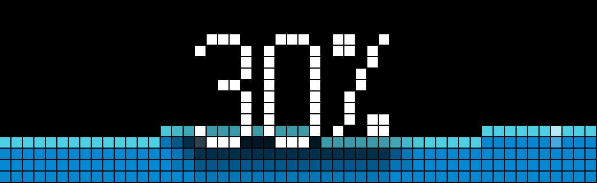
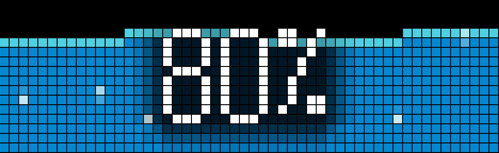
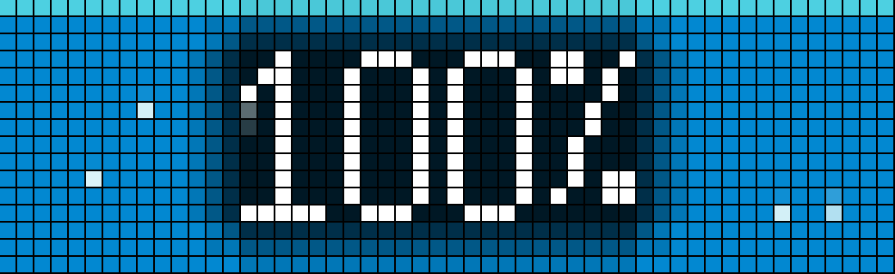
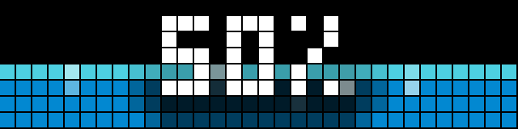
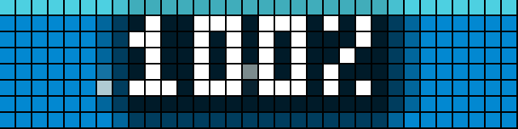

# 🌊 AWTRIX WaterLevel App

[](https://github.com/fshero/awtrix-waterlevel/releases/tag/v1.5.0)
[](https://github.com/Blueforcer/awtrix-ng)
[](https://berry-lang.github.io/)
[](https://opensource.org/licenses/MIT)

A dynamic, organic liquid level visualization app for **AWTRIX Light (Ulanzi TC001)** and **52×16 matrix displays (Ulanzi TC002 / DIY)**.

Connects to your local smart home setup via **MQTT** to display the current fill level of rainwater cisterns, water tanks, wells, or pools. Features a live fluid simulation with organic surface waves, rising air bubbles with subpixel anti-aliasing, and an adaptive drop-shadow for crystal-clear readability.

---

## 📸 Visual Showcase & Demos

### 52×16 Matrix (Ulanzi TC002 / DIY Displays)

The 52×16 version features gentle surface waves, rising air bubbles, soft contrast drop-shadows, and support for high-visibility 10-pixel bitmap digits.

| 30% Fill Level | 80% Fill Level | 100% Full Tank |
| :---: | :---: | :---: |
|  |  |  |
| *Gentle wave crests & ambient shadow* | *Subpixel bubbles rising through numbers* | *Foam waterline with bubble activity* |

---

### 32×8 Matrix (Ulanzi TC001 / Standard AWTRIX Light)

Tailored specifically for the 8-pixel height of the Ulanzi TC001, featuring a calm, flat waterline, perfectly centered digits, and smooth rising bubbles.

| 60% Fill Level | 100% Full Tank |
| :---: | :---: |
|  |  |
| *Calm flat waterline with centered digits* | *Full tank display on 32×8* |

---

## ✨ Key Features

- **Dynamic Liquid Animation:** Real-time water level visualization (0–100%) mapped accurately to matrix height.
- **Silky Smooth Subpixel Bubbles:** Continuous vertical subpixel anti-aliasing (`blend_colors`) ensures air bubbles glide upwards smoothly without discrete pixel jumps.
- **Organic Horizontal Wobble:** Air bubbles gently drift along a subtle sine curve as they float towards the surface.
- **Consistent Bubble Frequency:** Virtual cycle distance calculation ensures bubble spawn rate and frequency remain calm, steady, and identical whether the water level is at 10% or 100% (eliminates low-level bubble bursts).
- **Auto-Hide at 100% (Optional):** Automatically skip and hide the app from the carousel rotation when the tank is full, keeping your screen uncluttered. If 100% is reached while the app is active, it immediately advances to the next app using `rotation.next()`.
- **Adaptive Contrast Drop-Shadow:** A subtle ambient drop-shadow is rendered behind numbers and text to maintain high contrast and legibility over moving waves and bright bubbles.
- **Live MQTT Integration:** Subscribes to your custom MQTT topic and handles raw numeric values as well as common JSON payloads automatically.
- **Graceful No-Data State:** Displays `--%` in amber at a low baseline when waiting for initial sensor data.
- **Full Web UI Configuration:** Native settings integrated directly into the AWTRIX web interface.

---

## 🎛️ Matrix Variants & Hardware

| File | Target Matrix | Recommended Hardware | Highlights |
| :--- | :--- | :--- | :--- |
| **`WaterLevelV2_52x16.ax`** | **52×16** | Ulanzi TC002, DIY ESP32 Matrix | Sine-wave crests, 10px large font mode, customizable text alignments (`left`, `center`, `right` / `top`, `middle`, `bottom`). |
| **`WaterLevelV2_32x8.ax`** | **32×8** | Ulanzi TC001, standard AWTRIX Light | Flat waterline, permanently centered standard font, optimized memory budget for 8-pixel panels. |

---

## 🚀 Installation

1. Download the app script matching your display size from the [Releases](https://github.com/fshero/awtrix-waterlevel/releases) page or repository root:
   - For **Ulanzi TC002 / 52×16**: `WaterLevelV2_52x16.ax`
   - For **Ulanzi TC001 / 32×8**: `WaterLevelV2_32x8.ax`
2. Open your AWTRIX web interface (e.g. `http://awtrix.local` or your device's IP).
3. Go to the **Apps** (or **Scripts**) tab.
4. Click **Upload** and select the `.ax` file (or create a new script and paste the code).
5. The app will immediately start and appear in your display rotation.

---

## ⚙️ Configuration

Open your AWTRIX web interface, navigate to the **Apps** tab, and click the **Gear (⚙️) icon** next to **WaterLevel** to configure settings:

### 52×16 Variant (`WaterLevelV2_52x16.ax`)

| Setting | Type | Default | Description |
| :--- | :--- | :--- | :--- |
| **MQTT Topic** | Text | *(empty)* | MQTT topic publishing the level data (e.g. `home/cistern/level`). |
| **Wave & Bubble Speed** | Number (1–10) | `3` | Adjusts wave oscillation and bubble rise speed. |
| **Large Centered Text** | Select (`no` / `yes`) | `no` | Displays large 10px numbers centered on screen. When enabled, alignment options are bypassed. |
| **Text Shadow** | Select (`no` / `yes`) | `yes` | Soft drop-shadow behind text to enhance contrast over moving waves. |
| **Hide when Full (100%)** | Select (`no` / `yes`) | `no` | Automatically hides the app from the carousel rotation when the water level reaches 100%. |
| **Horizontal Alignment** | Select | `left` | Standard text horizontal alignment: `left`, `center`, or `right`. |
| **Vertical Alignment** | Select | `top` | Standard text vertical alignment: `top`, `middle`, or `bottom`. |

### 32×8 Variant (`WaterLevelV2_32x8.ax`)

| Setting | Type | Default | Description |
| :--- | :--- | :--- | :--- |
| **MQTT Topic** | Text | *(empty)* | MQTT topic publishing the level data. |
| **Bubble Speed** | Number (1–10) | `3` | Adjusts the rise speed of the air bubbles. |
| **Text Shadow** | Select (`no` / `yes`) | `yes` | Soft drop-shadow behind text to enhance contrast over the water. |
| **Hide when Full (100%)** | Select (`no` / `yes`) | `no` | Automatically hides the app from the carousel rotation when the water level reaches 100%. |

---

## 📡 Smart Home & MQTT Integration

The app automatically parses incoming MQTT payloads. Point the app to your topic and publish the fill level percentage (`0` to `100`).

### Supported Payload Formats

1. **Plain Number (String, Integer, or Float):**
   ```text
   75
   ```
   ```text
   82.4
   ```

2. **JSON Object:**
   The parser automatically searches for standard keys (`percent`, `level`, `value`, `val`):
   ```json
   {"percent": 75}
   ```
   ```json
   {"level": 82.5, "unit": "%"}
   ```
   ```json
   {"value": 100}
   ```

### Home Assistant Example

You can easily publish your cistern or tank sensor state to MQTT using a Home Assistant automation:

```yaml
automation:
  - alias: "Publish Cistern Level to AWTRIX"
    trigger:
      - platform: state
        entity_id: sensor.cistern_fill_percentage
    action:
      - service: mqtt.publish
        data:
          topic: home/cistern/level
          payload: "{{ states('sensor.cistern_fill_percentage') | round(0) }}"
          retain: true
```

---

## 📝 Changelog

See [CHANGELOG.md](CHANGELOG.md) for full release notes and version history.

---

## 📄 License

This project is open-source software licensed under the [MIT License](LICENSE).
